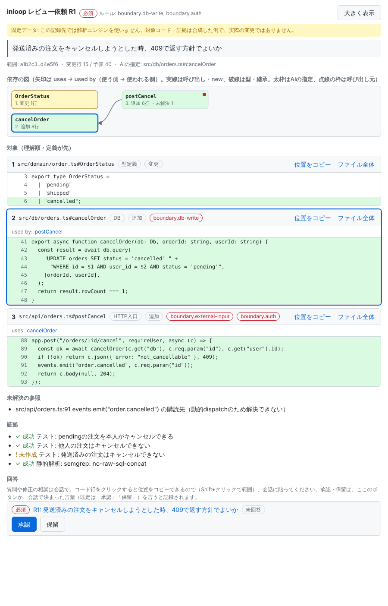
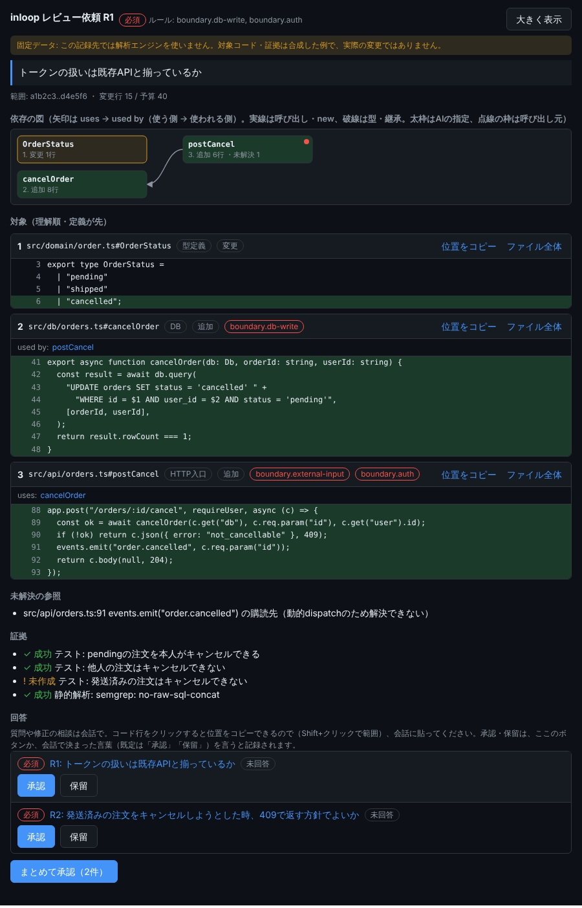

# inloop

**AIコーディングに、人間の納得感を取り戻すためのレビュー基盤**

inloopは、AIエージェントがコードを書く開発で、人間を判断の輪（human-in-the-loop）の中に入れ続けるためのツールです。

AIは人間がレビューしきれない量のコードを生成できます。人間が自分で書いたコードを信頼できるのは、品質が高いからではなく、書く速度が理解の速度と一致していて、書きながらレビューできていたからです。inloopは、AIの生成速度を人間の理解速度に合わせ直します。

## 何をするか

- **AIが人にレビューを依頼する。** 人が対象を探しに行くのではなく、AIが機能ごとに「この観点で見てほしい」と依頼票を出します。
- **依頼票の中身はAIなしで組み立てる。** 対象コード（理解順に並べたシンボル）、データの流れ、影響範囲、テスト結果は、解析エンジンがコードから決定的に生成します。AIが書くのは問いの文だけです。
- **信頼境界に触れた変更は必ず依頼される。** 認証、外部入力、秘密情報、DB書き込みなどに触れた変更は、ルールによって自動で依頼対象になり、AIはこれを取り消せません。
- **人の回答で後続タスクが動く。** 承認・修正依頼・質問・保留を構造化して返し、修正後は前回からの差分だけを再依頼します。
- **AIクライアントの中で完結する。** MCPサーバーとして動き、レビューUIはMCP Appsとしてクライアント内に表示されます。自作のIDEやAPI課金を必要としません。

## 画面

レビュー依頼の画面（左: ライト、右: ダーク）。依存の図、理解順に並べたコード、証拠、承認・保留のボタンが並びます（固定データの例）。

<p>
  
  
</p>

`inloop generate scaffold`で作れる画面などは[UIギャラリー](docs/gallery.md)にあります。

## インストール

必要なもの: Node.js 22.13以上、git、[Claude Code](https://claude.com/claude-code)。動作を確かめているのはmacOSです（Linux・Windowsは未確認）。

```sh
git clone https://github.com/tazyamah/inloop.git
cd inloop
npm ci
npm run build
export PATH="$PWD/bin:$PATH"   # シェルの設定ファイルにも足しておく
inloop --help
```

`npm test`でテストを動かせます。更新は、`inloop update`です。AIクライアントへの登録の詳細は[docs/client-verification.md](docs/client-verification.md)にあります。

## 使い方（最短の手順）

```sh
inloop new myapp                 # 標準の構成（React＋Hono＋SQLite）のアプリを作る
cd myapp
npm install
npm run dev                      # 画面 http://127.0.0.1:5173
inloop generate scaffold task title:text done:bool due:date:optional   # 表・API・テスト・画面を生成
```

`inloop new`は、アプリに`.mcp.json`を書きます。そのフォルダをClaude Codeで開き（初回はinloopのMCPサーバーを使うかを聞かれるので許可）、「○○を管理する機能を作って」と頼みます。AIが変更を作ると、信頼境界に触れた変更（認証、外部入力、DB書き込みなど）にはレビュー依頼が出ます。表示されるURL（`http://<アプリ名>.inloop.localhost:4656/r/R1`の形）をブラウザで開いて内容を確かめ、承認か保留を押します。`inloop check`で、必須の依頼がすべて承認済みかを確かめられます。

`inloop new`の`--desktop`（Tauriのデスクトップアプリ）、`--standalone`（サーバーなし、ブラウザ・PWAで動く）、`--sync`（端末どうしの共有つき）で、ほかの構成も作れます。

## 状態

MCPサーバー、レビューUI、`inloop`コマンド、解析エンジン（TypeScriptとSQL）、信頼境界ルール、証拠の取り込み、アプリの雛形（サーバー向け、デスクトップ、端末内で動く、共有つき）があります。実際のクライアントで確かめているのは、macOSとClaude Code（デスクトップ）の構成です。確認済みの範囲と未検証の事項は[maintainer-guide/handoff.md](maintainer-guide/handoff.md)にあります。まだ0.0.0で、`package.json`は`private: true`です（npmには公開していません）。

## ライセンス

[MIT License](LICENSE)です。依存するパッケージのライセンス、`inloop new`が作るアプリに入る素材、アイコンの扱いは[docs/licensing.md](docs/licensing.md)にあります。

## 文書

- 紹介スライド（発表者モード・PDF印刷つき、単一HTML）: [docs/slides/inloop-intro.html](docs/slides/inloop-intro.html)（GitHub上ではソース表示になるので、手元に保存してブラウザで開く）
- UIギャラリー: [docs/gallery.md](docs/gallery.md)
- 依頼票の図と、その作り方: [docs/diagrams.md](docs/diagrams.md)
- 考え方: [docs/concept.md](docs/concept.md)
- 構成: [docs/architecture.md](docs/architecture.md)
- 開発のイテレーション: [docs/iteration.md](docs/iteration.md)
- レビュー依頼のプロトコル: [docs/review-protocol.md](docs/review-protocol.md)
- クライアント検証: [docs/client-verification.md](docs/client-verification.md)
- 開発者向け: [AGENTS.md](AGENTS.md)、[maintainer-guide/](maintainer-guide/README.md)
