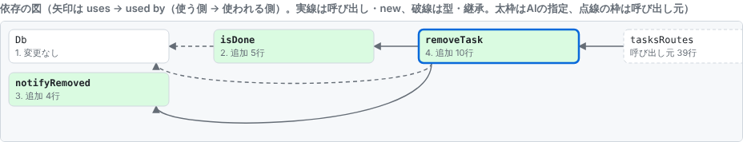
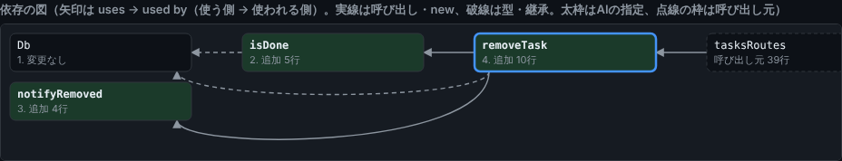
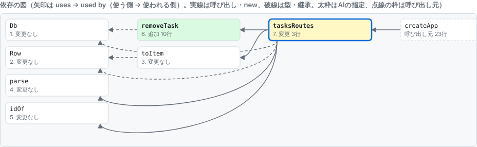
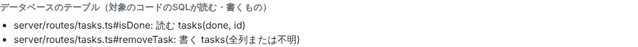
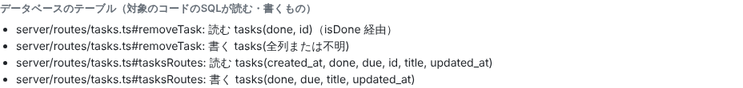
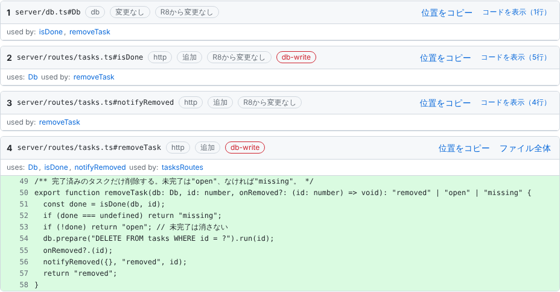
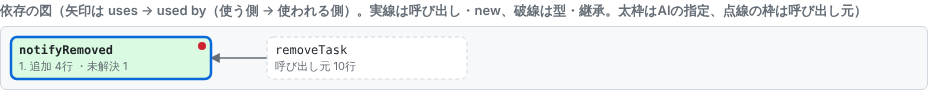

# 依頼票の図と、その作り方

inloopのレビュー依頼票（AIが`request_review`で出し、人が読んで承認・保留を押す画面）に出てくる図と、図に近い一覧を、種類ごとに実例つきでまとめます。どれも、解析エンジンがコードから決めたものです。AIは図の中身に関与しません（[ADR-0002](../maintainer-guide/decisions/0002-deterministic-review-projection.md)）。

この文書の画像と抜粋は、手で描いたものではありません。実際のエンジン（`request_review`）が作った依頼票を、実際のレビューUIで開いて撮ったものです。作り直す手順は[末尾](#サンプルの作り直し)にあります。

## 先に結論: 図は「依存の図」の1種類だけ

| 出力 | 形 | 何を表すか |
|---|---|---|
| [依存の図](#1-依存の図) | 図（SVG） | 依頼に並べたシンボルどうしの「使う関係」。呼び出し元の列と、変更・未解決の印つき |
| [データベースのテーブル](#2-データベースのテーブル) | 一覧 | 対象のコードのSQLが読む・書くテーブルと列 |
| [境界・レイヤーの印](#3-境界とレイヤーの印) | 見出しの札 | そのシンボルが属するレイヤーと、当たった信頼境界ルール |
| [再依頼の畳み](#4-再依頼の畳み) | 見出しの札と折りたたみ | 前の依頼から変わっていないシンボル |
| [未解決の参照](#5-未解決の参照) | 一覧と図の印 | 解析で行き先を決められなかった呼び出し |

**ER図とデータフロー図は、生成しません。** 理由は次のとおりです。

- データフロー図: 値がどの引数からどこへ渡るかは、今の解析エンジン（呼び出し関係までの解析）では追えません。作れないものを作れるふりをしないため、図の名前も「データの流れ」ではなく「依存の図」にしています（[ADR-0020](../maintainer-guide/decisions/0020-dependency-graph-view.md)の「名前」）。[ADR-0002](../maintainer-guide/decisions/0002-deterministic-review-projection.md)には依頼票の構成要素として「データの流れ」と書かれていますが、実装はこの範囲までです。
- ER図: テーブルの関係（外部キー、列の型）を図にする機能はありません。[データベースのテーブル](#2-データベースのテーブル)は、SQL文から読み取れる「どのコードがどのテーブルの何の列を読む・書くか」の一覧で、テーブルどうしの関係は含みません。

（作る場合は、新しい解析と依頼票の項目が要るので、ADRを立てて決めることになります。）

## 生成の流れ: 解析 → 依頼票（中間表現）→ 描画

```text
 git の範囲        対象のリポジトリ                AIが指定した
 (例: HEAD)   ┌──  tsconfig.json のコード  ┐       シンボルID・観点の文
      │       │    inloop.json（ルール）   │              │
      ▼       ▼                            ▼              ▼
  ┌────────────────────────────────────────────────────────────┐
  │ 解析エンジン（src/engine/）                                │
  │  project.ts  TypeScriptの型解決で、宣言・参照を求める       │
  │  diff.ts     git diffで、変わった行を求める                 │
  │  sql.ts      SQL文字列から、読む・書くテーブルと列を取り出す │
  │  boundaries.ts  inloop.jsonのルールを当てる                │
  │  build.ts    並べる順・使う関係・呼び出し元を決める         │
  └───────────────────────────┬────────────────────────────────┘
                              ▼
          依頼票 ReviewPacket（JSON。記録としてリポジトリの.inloop/に残る）
          steps / edges / callers / tables / unresolved / prior ...
                              ▼
  ┌────────────────────────────────────────────────────────────┐
  │ レビューUI（src/ui/）                                      │
  │  graph.ts   edges と steps だけから、依存の図のSVGを描く    │
  │  main.ts    テーブルの一覧、札、折りたたみを描く            │
  └────────────────────────────────────────────────────────────┘
```

（上の枠は構成の説明で、実行結果ではありません。）

要点は3つです。

1. **図の元は、依頼票に残ります。** 画面は依頼票の項目だけを読んで描き、コードから関係を推し量りません。エンジンが確かめていない線を引かないためです。記録に残るので、後から開いても、依頼したときの図が見えます。
2. **同じ入力からは、同じ出力になります。** 並びは、理解順（定義が先）、ファイルと位置、種類の順で決めています。この文書のサンプルを作るスクリプトを2回動かして、抜粋のJSONが一致することを確かめています。
3. **AIが書けるのは、観点の文とシンボルIDの指定だけです。** 図の箱・線・テーブル・札は、AIが関与できません。

### 解析の手順（`buildPackets`、`src/engine/build.ts`）

1. 指定されたシンボルを探す。1つでも見つからなければ、依頼票を作らずに拒否する（fail-closed）。
2. 指定したシンボルごとに、直接使う同じリポジトリのシンボル（呼び出し、`new`、型の参照、継承）を求めて、並べるシンボルに加える。リポジトリの外（`node_modules`、標準ライブラリ）は並べない。間接の依存はたどらない（[ADR-0015](../maintainer-guide/decisions/0015-typescript-analysis-engine-v1.md)）。
3. 並べたシンボルどうしの使う関係を、種類つきで`edges`にする。
4. 定義が先になる理解順に並べ、gitの差分から、変わった行（`changedLines`）と、追加・変更・変わっていないの別（`change`）を付ける。
5. 並べたシンボルを呼び出している、ほかのシンボルを1段だけ探して`callers`にする（[ADR-0021](../maintainer-guide/decisions/0021-callers-in-dependency-graph.md)）。
6. SQL文字列から、読む・書くテーブルを`tables`にする（[ADR-0026](../maintainer-guide/decisions/0026-sql-table-access.md)、[0030](../maintainer-guide/decisions/0030-indirect-sql-tables.md)、[0031](../maintainer-guide/decisions/0031-sql-columns.md)）。
7. 行き先を決められなかった参照を`unresolved`にする。
8. `inloop.json`のルールを当てて、レイヤーと信頼境界の札を付ける。必須の依頼は、別の依頼票として足される（[ADR-0022](../maintainer-guide/decisions/0022-trust-boundary-rules.md)）。

## サンプルの題材

サンプルはすべて、同じ小さなアプリ（`tasks-demo`）に変更を足して作ったものです。

- `inloop new`で作った標準の構成（React＋Hono＋SQLite）に、`inloop generate scaffold task title:text done:bool due:date:optional`でタスクの表・API・画面を足したもの
- そこへ「完了済みのタスクだけ削除でき、未完了は409にする」変更を足した（`server/routes/tasks.ts`の`removeTask`・`isDone`・`notifyRemoved`の追加と、`DELETE`の書き換え。`server/db.ts`に列の追加）

依頼のID（`R5`など）は、同じ記録の中の通し番号なので、作り直したときの値によって変わります。

## 1. 依存の図

**何を表すか**: 依頼に並べたシンボル（関数、クラス、型など）どうしの、使う関係です。矢印は「使う側 → 使われる側」の向きで、使われる側が左に来ます。

**入力**: `steps`（並べたシンボル）と`edges`（使う関係）、`callers`（呼び出し元）、`unresolved`（未解決）。コードの解析結果だけで、AIの文は使いません。

**例**: 「完了済みのタスクだけ削除する」`removeTask`を、AIが対象に指定した依頼です。

| ライト | ダーク |
|---|---|
|  |  |

図の見方:

| 見た目 | 意味 |
|---|---|
| 太い青の枠 | AIが指定した対象（`removeTask`） |
| 緑・黄・白の箱 | 追加・変更・変わっていない（`変更 3行`のように変えた行数も出る） |
| 箱の中の番号 | 理解順（定義が先）。`Db`が1、`removeTask`が4 |
| 実線の矢印 | 呼び出しか`new`がある |
| 破線の矢印 | 型の参照か継承だけ（`isDone → Db`は引数の型として使っているだけ） |
| 点線の枠の箱（右端） | 呼び出し元（`tasksRoutes`）。並べたシンボルを呼んでいる、ほかのシンボル。1段だけ |
| 箱の下を回る線 | 隣の列を飛ばす線（`removeTask → Db`など）と、循環で戻る線 |
| 箱の右上の赤い点 | 未解決の参照を含む（[未解決の参照](#5-未解決の参照)） |

箱を押すと、そのシンボルのコードへ移ります。箱に乗ると、つながる線だけが強調されます。

**この図の元（依頼票の抜粋）**: 実際の依頼票の`edges`と`callers`です（全体は[`diagrams/packets.json`](diagrams/packets.json)の`graph`）。

```json
"edges": [
  { "from": "server/routes/tasks.ts#isDone",      "to": "server/db.ts#Db",                    "kind": "type" },
  { "from": "server/routes/tasks.ts#removeTask",  "to": "server/db.ts#Db",                    "kind": "type" },
  { "from": "server/routes/tasks.ts#removeTask",  "to": "server/routes/tasks.ts#isDone",      "kind": "call" },
  { "from": "server/routes/tasks.ts#removeTask",  "to": "server/routes/tasks.ts#notifyRemoved","kind": "call" },
  { "from": "server/routes/tasks.ts#tasksRoutes", "to": "server/routes/tasks.ts#removeTask",  "kind": "call" }
],
"callers": [
  { "symbol": "server/routes/tasks.ts#tasksRoutes", "file": "server/routes/tasks.ts", "startLine": 65 }
]
```

（列を揃えるため、空白だけ整えています。値は出力のままです。）

`kind`は`call`（呼び出し）、`new`（コンストラクター）、`type`（型の参照）、`inherit`（継承・実装）の4種類です。`from`が`to`を使います。

**図の作り方**（`src/ui/graph.ts`）:

1. 依存の深さで列を分ける。何も使わないものが0列目（左端）、使うものの深さの最大＋1が次の列。呼び出し元は、並べたシンボルの右に1列で置く。循環は、たどっている途中のものを0とみなして切る。
2. 列の中は理解順。2列目からは、使う先の行の平均が上のものから置いて、線の交差を減らす。
3. 同じ2つの間の線は1本にまとめる。呼び出しか`new`があれば実線、型と継承だけなら破線。種類は線にカーソルを乗せたときの説明に並ぶ。
4. 列を飛ばす線と、同じ列・逆向きになる線は、箱の下を回す。

外部のグラフ描画ライブラリ（mermaidなど）は使わず、SVGを自前で描きます。画面を外部依存のない単一HTMLに保ち、並びが決定的であることを確かめやすくするためです（[ADR-0020](../maintainer-guide/decisions/0020-dependency-graph-view.md)）。

### 大きめの例: 必須の依頼

`inloop.json`のルールが当たると、AIの指定とは別に、必須の依頼が自動で作られます。これは、`tasksRoutes`（HTTPの入口）を対象にした必須の依頼で、依存が増えるぶん、箱の下を回る線が出ます。



`tasksRoutes`は、`toItem`・`parse`・`idOf`・`removeTask`を呼び、`Db`と`Row`を型として参照しています。右端の`createApp`は呼び出し元です。

## 2. データベースのテーブル

**何を表すか**: 対象のコードの`prepare`・`exec`に渡したSQL文字列から読み取れた、読む・書く・スキーマ変更のテーブルと、読み取れた列です。ER図ではなく、テーブルどうしの関係（外部キーなど）は含みません。

**入力**: 並べたシンボルの本文にあるSQL文字列。SQL文を完全には構文解析せず、字句に分けて、`FROM`・`JOIN`・`INTO`・`UPDATE`・`CREATE TABLE`などの直後の名前を拾います（`src/engine/sql.ts`）。

**例1**（`removeTask`の依頼）:



```json
"tables": [
  { "symbol": "server/routes/tasks.ts#isDone",     "table": "tasks", "access": "read",  "columns": ["done", "id"] },
  { "symbol": "server/routes/tasks.ts#removeTask", "table": "tasks", "access": "write", "columns": ["*"] }
]
```

**例2**（`tasksRoutes`の必須の依頼）: 並べていないシンボルの中のSQLも、呼び出しを2段までたどって探し、「経由」として出します。



`removeTask`の「読む」は、`removeTask`が呼ぶ`isDone`の中のSQLです（`"via": ["server/routes/tasks.ts#isDone"]`）。

読み方:

- `access`は`read`（読む）、`write`（書く）、`schema`（`CREATE TABLE`など）。
- `columns`の`*`は「全列、または列を決められない」を表す。決められないときは、当たる側（広い側）に倒す（[ADR-0031](../maintainer-guide/decisions/0031-sql-columns.md)）。
- 文字列を組み立てるSQLのように読めないものは、推測せず、[未解決の参照](#5-未解決の参照)に出す。

## 3. 境界とレイヤーの印

**何を表すか**: 各シンボルの見出しにつく札です。灰色の札はレイヤー（`http`、`db`など）、赤い札は当たった信頼境界ルール（`db-write`、`http-input`など）です。

**入力**: 対象のリポジトリ直下の`inloop.json`の`layers`（ファイルからレイヤーを決める）と`boundaries`（ルールの当て方）。ルールが当たったシンボルには、そのルールの問いを観点にした必須の依頼が自動で作られ、AIの判断では省略できません。

**例**（`tasksRoutes`の見出し）:


依頼票の対応する項目は、次のとおりです。

```json
{ "symbol": "server/routes/tasks.ts#tasksRoutes", "layer": "http", "boundaries": ["db-write", "http-input"], "change": "modified" }
```

## 4. 再依頼の畳み

**何を表すか**: 指摘を受けて直し、同じ依頼を出し直す（再依頼、`follows`）とき、前の依頼から**コードが変わっていないシンボル**を、「`R8`から変更なし」の札をつけて畳みます。人が読み直す量を、変わった部分に寄せるためです（[ADR-0029](../maintainer-guide/decisions/0029-folded-lines-and-reread-diff.md)、[0033](../maintainer-guide/decisions/0033-fold-same-without-answer.md)）。

**入力**: 前の依頼票に残したシンボルのコードと、今のコードの比較。違いがあれば畳まない。指摘（修正・質問）を受けたシンボルと、保留のあとは畳まない。

**例**（`removeTask`にコメントを1行足して再依頼したもの。`isDone`と`Db`は同じなので畳まれ、`removeTask`だけ全行が出る）:



```json
"prior": { "id": "R8", "same": ["server/db.ts#Db", "server/routes/tasks.ts#isDone", "server/routes/tasks.ts#notifyRemoved"] }
```

畳んだコードは、「コードを表示」で全行を開けます。省くのではなく、畳むだけです。変わっていない依存（AIが指定していないもの）と、呼び出し元も、同じように既定で畳みます（[ADR-0020](../maintainer-guide/decisions/0020-dependency-graph-view.md)）。

## 5. 未解決の参照

**何を表すか**: 解析で行き先を決められなかった参照（動的な呼び出しなど）です。推測でつながず、「未解決」と明示します。図では、含むシンボルの箱の右上に赤い点と件数が出ます。

**入力**: 参照の解決の結果。解決できなかったものは、`ファイル:行 式`の文字列として`unresolved`に入ります。

**例**: 通知の種類を実行時に決める`notifyRemoved`（`hooks[kind](id)`）を対象にした依頼です。

| 図 | 一覧 |
|---|---|
|  |  |

```json
"unresolved": ["server/routes/tasks.ts:62 hooks[kind]"]
```

`removeTask → notifyRemoved`の線はあっても、`notifyRemoved`の中の`hooks[kind]`の呼び先は、線にしていません。

## 作っていないもの（証拠の表示）

依頼票の「証拠」（テストや静的解析の結果）も、一覧で出します（成功・失敗・未作成）。`inloop.json`に`evidence`を書いて`inloop evidence run`を動かしたときに出るもので、このサンプルの題材には設定がないため、この文書にサンプルはありません（[ADR-0024](../maintainer-guide/decisions/0024-evidence-runs.md)、[0025](../maintainer-guide/decisions/0025-evidence-symbol-binding.md)）。

## サンプルの作り直し

画面かエンジンを変えたら、次で、この文書の画像（`docs/diagrams/*.png`）と依頼票の抜粋（`docs/diagrams/packets.json`）を作り直します。

```sh
npm install
npm run build
# Playwright（Chromium）が使える環境で。Chromiumの場所を指定するときは INLOOP_CHROMIUM
node scripts/diagram-samples.mjs            # 出力先を変えるときは、引数に出力先
```

`scripts/diagram-samples.mjs`が行うことは、次のとおりです。

1. 一時フォルダに、`inloop new`と`inloop generate scaffold`で題材のアプリを作り、`npm install`して、commitする（登録先のホームも一時フォルダにするので、手元のinloopの登録は変わらない）。
2. 変更を足す（上の[サンプルの題材](#サンプルの題材)）。
3. 実際のMCPサーバー（`createServer`）の`request_review`を呼んで、依頼票を作る。
4. 実際のレビューUI（`dist/ui/review.html`）を、会話内表示と同じ方法（MCP Appsのホスト）でChromiumに開き、図や一覧の部分を撮る。
5. UIが読むのと同じ`inloop_get_request`で依頼票を取り、抜粋（コード本文を除く）を`packets.json`に書く。

雛形（`templates/`）や図のコードを変えたあとに、このスクリプトが「置き換え元が見つからない」と失敗したら、題材の変更の書き方を雛形に合わせて直します。画像は、画面の写真の一覧（[gallery.md](gallery.md)）と同じく、画面を変えたら撮り直します（[開発者向けの手順](../maintainer-guide/screenshots.md)）。

## 関連資料

- [architecture.md](architecture.md): 構成と解析エンジンの方針
- [review-protocol.md](review-protocol.md): 依頼票とツールの形
- [gallery.md](gallery.md): 画面の写真
- ADR: [0002](../maintainer-guide/decisions/0002-deterministic-review-projection.md)、[0015](../maintainer-guide/decisions/0015-typescript-analysis-engine-v1.md)、[0020](../maintainer-guide/decisions/0020-dependency-graph-view.md)、[0021](../maintainer-guide/decisions/0021-callers-in-dependency-graph.md)、[0022](../maintainer-guide/decisions/0022-trust-boundary-rules.md)、[0026](../maintainer-guide/decisions/0026-sql-table-access.md)、[0029](../maintainer-guide/decisions/0029-folded-lines-and-reread-diff.md)、[0030](../maintainer-guide/decisions/0030-indirect-sql-tables.md)、[0031](../maintainer-guide/decisions/0031-sql-columns.md)
