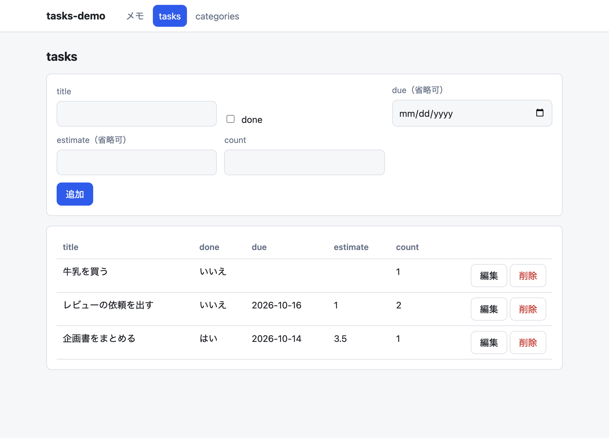
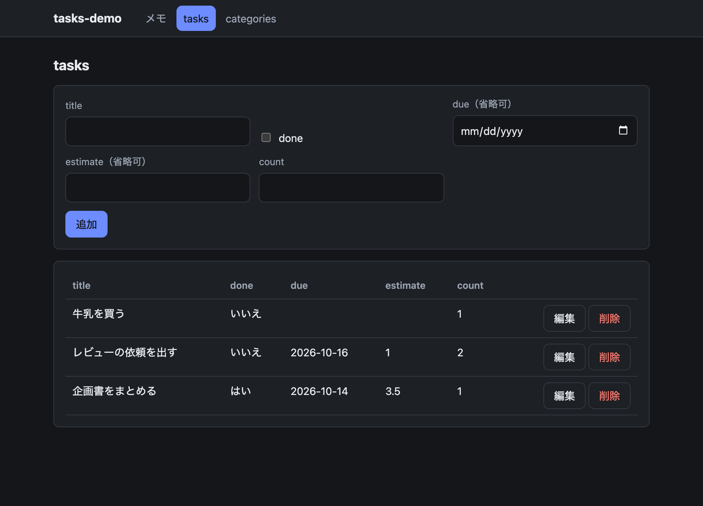
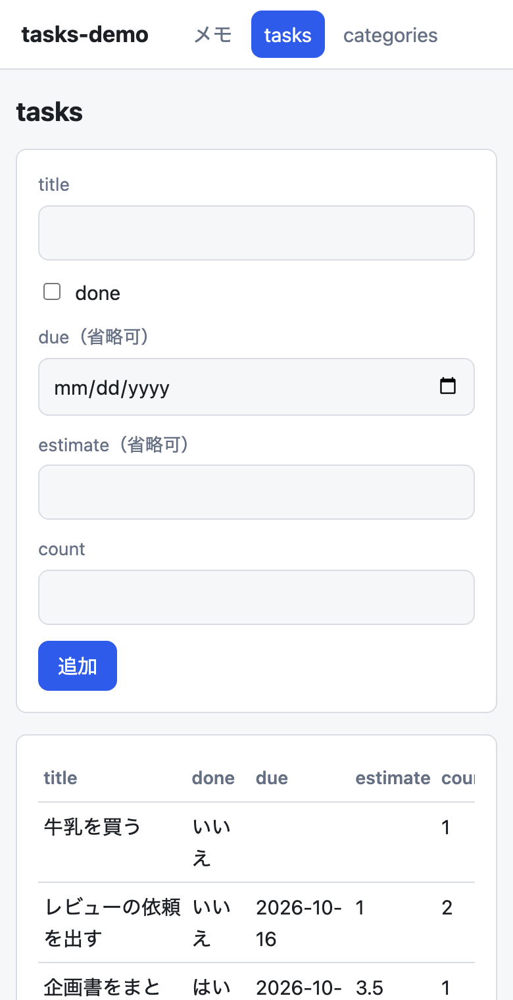

# UIギャラリー

inloopが出す画面の一覧です。画面の写真は、ここに載せたもので全部ではありません。

## レビュー依頼の画面

AIが`request_review`で出した依頼を、人が読んで承認・保留を押す画面です。上から、依頼の問い、依存の図、理解順に並べた対象コード、未解決の参照、証拠、回答のボタンです。必須の依頼には「必須」と、当たったルールが出ます。

これらは、テスト用の固定データ（実際の変更ではない例）を実ブラウザで表示したものです（`INLOOP_UI_E2E=1 INLOOP_SHOT_DIR=<dir> npm test`で撮れる）。

| ライト | ダーク |
|---|---|
|  |  |

## `inloop generate scaffold`が出す画面

`inloop generate scaffold task title:text done:bool due:date:optional`のように作った資源の、一覧の表と追加・編集のフォームです。ライトとダーク、狭い画面に対応します（共通のCSS`web/src/style.css`）。下の写真は`tasks-demo`というアプリで撮ったものです。

| ライト | ダーク |
|---|---|
|  |  |

狭い画面（スマートフォン幅）:

## 撮り直し

画面を変えたら、写真も撮り直します。レビュー依頼の画面は上の環境変数で、scaffoldの画面は`inloop new`と`inloop generate scaffold`でアプリを作り、`npm run dev`の画面を撮ります。
