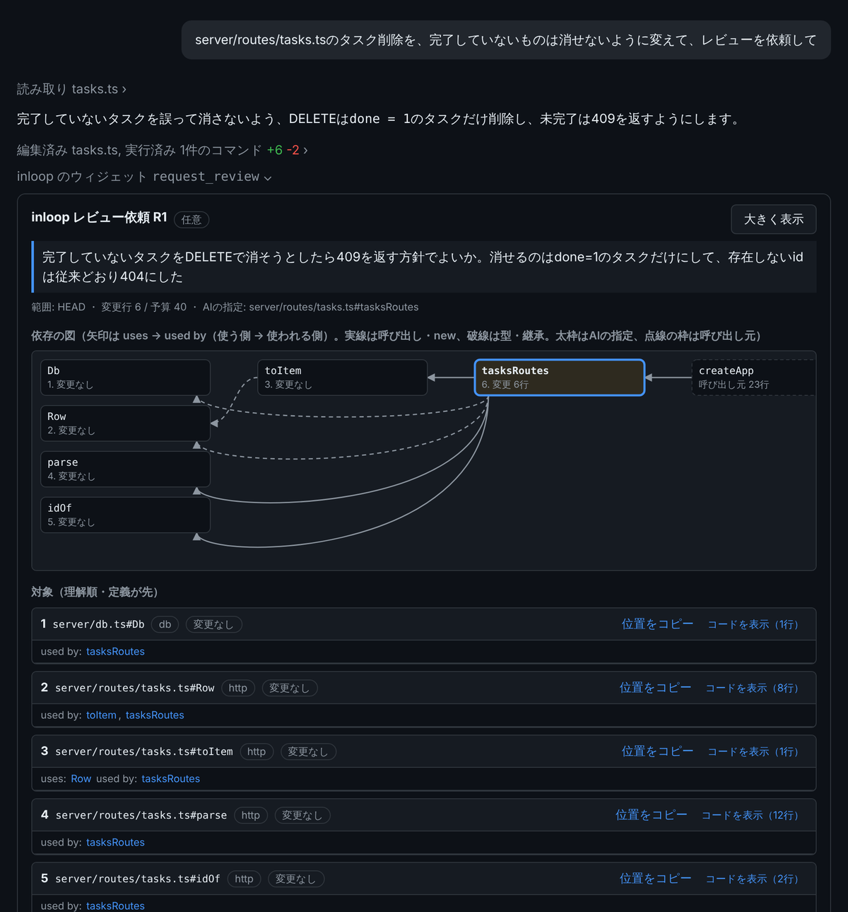
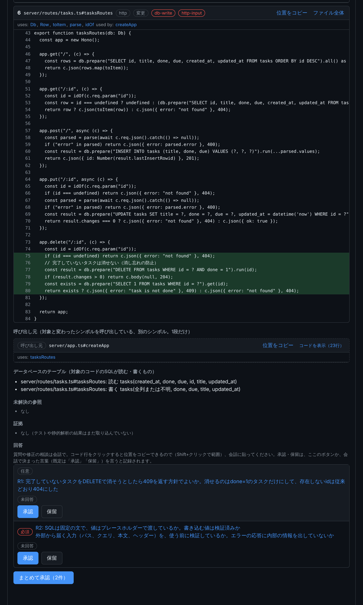

# UIギャラリー

inloopが出す画面の一覧です。写真の撮り直し方は[開発者向けの手順](../maintainer-guide/screenshots.md)にあります。

## レビュー依頼の画面

AIが`request_review`で出した依頼を、人が読んで承認・保留を押す画面です。上から、依頼の問い、依存の図、理解順に並べた対象コード、未解決の参照、証拠、回答のボタンです。必須の依頼には「必須」と、当たったルールが出ます。

これらは、テスト用の固定データ（実際の変更ではない例）を実ブラウザで表示したものです（`INLOOP_UI_E2E=1 INLOOP_SHOT_DIR=<dir> npm test`で撮れる）。

| ライト | ダーク |
|---|---|
|  |  |

## Claude Codeの会話の中での見え方

Claude Code（デスクトップ）の会話に、AIが`request_review`を呼ぶと、依頼票が「inloop のウィジェット」として会話の中に出ます。問い、依存の図、理解順に並べた対象コードが、会話を離れずに読めます。

下の画面は、`inloop new`と`inloop generate scaffold task title:text done:bool due:date:optional`で作ったタスク管理アプリで、「完了していないタスクは削除できない」変更をした例です。依頼票の中身は実際の解析エンジンの出力で、会話の枠（依頼文、AIの返答）は見え方を示すために組んだものです。実際のClaude Codeの画面そのものではありません。

続き。変更した行（緑）、読み書きするテーブル、必須の依頼（信頼境界ルールが自動で出したもの）と承認・保留のボタンです。

## `inloop generate scaffold`が出す画面

`inloop generate scaffold task title:text done:bool due:date:optional`のように作った資源の、一覧の表と追加・編集のフォームです。ライトとダーク、狭い画面に対応します（共通のCSS`web/src/style.css`）。下の写真は`tasks-demo`というアプリで撮ったものです。

| ライト | ダーク |
|---|---|
|  |  |

狭い画面（スマートフォン幅）:

